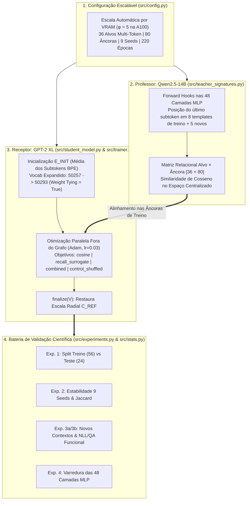
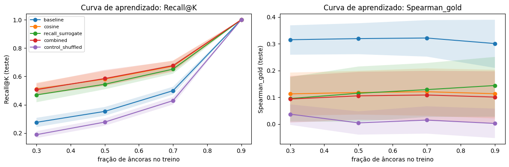
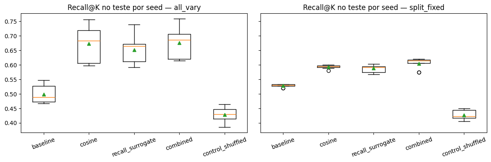
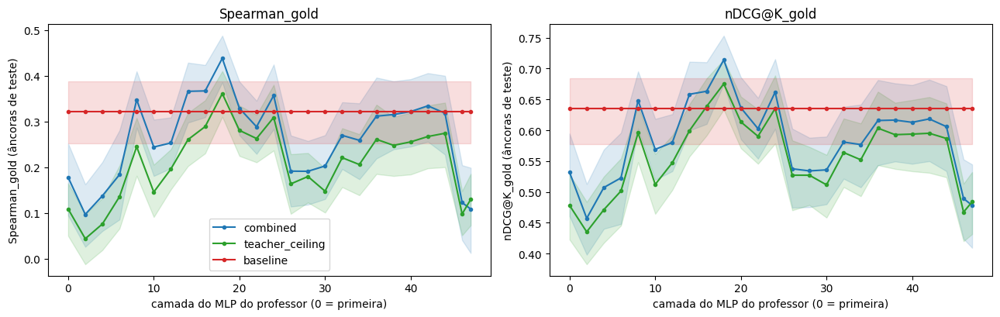

# 🧬 Transferência Cross-Tokenizer de Vocabulário por Ativações entre LLMs (`Método A` & Evolução `PARAM + WIP`)

> **Projeto Final — Deep Learning (UNICAMP)**  
> **Autores:**  
> - **Marcelo Montandon Magalhães** (RA: `259118`)  
> - **Mateus Leite de Souza Lima** (RA: `239861`)  
>
> **Modelos Avaliados ($\phi = 5$):** Professor `Qwen/Qwen2.5-14B` ($d = 5120$, 48 camadas MLP) $\longrightarrow$ Receptor `openai-community/gpt2-xl` ($d = 1600$, Weight Tying = `True`)

---

## 🎯 Guia de Apresentação pelo GitHub (Roteiro Slide a Slide)

Este repositório foi estruturado para permitir a **apresentação interativa direta pela interface web do GitHub**, conectando cada slide de [`Plano de Progressão.pdf`](Plano%20de%20Progressão.pdf) aos capítulos visuais em [`docs/`](docs/) e aos módulos de código-fonte em [`src/`](src/) extraídos de [`Metodo_A_Validacao_Escalavel.ipynb`](Metodo_A_Validacao_Escalavel.ipynb):

| Ordem de Apresentação | Slides Equivalentes (`Plano de Progressão.pdf`) | Capítulo de Apresentação (Clique para Abrir) | Módulos Python Correspondentes (`src/`) |
| :---: | :--- | :--- | :--- |
| **Parte 1** | **Slides 1 a 4 e 8 a 10:** Motivação, Mecanismo em 4 Passos, *Tied Weights* e Escala $\phi$ | 📄 **[`docs/01_Motivacao_Mecanismo_e_Escala.md`](docs/01_Motivacao_Mecanismo_e_Escala.md)** | [`src/config.py`](src/config.py)<br>[`src/student_model.py`](src/student_model.py)<br>[`src/teacher_signatures.py`](src/teacher_signatures.py) |
| **Parte 2** | **Slides 4 e 5:** Experimento 1 — Separação de Âncoras de Treino vs. Teste e Memorização | 📊 **[`docs/02_Exp1_Generalizacao_Treino_Teste.md`](docs/02_Exp1_Generalizacao_Treino_Teste.md)** | [`src/metrics.py`](src/metrics.py)<br>[`src/trainer.py`](src/trainer.py)<br>[`src/stats.py`](src/stats.py) |
| **Parte 3** | **Slides 4 e 5:** Experimento 2 — Estabilidade entre Seeds (`all_vary` vs. `split_fixed`) e Jaccard | 📈 **[`docs/03_Exp2_Estabilidade_Seeds.md`](docs/03_Exp2_Estabilidade_Seeds.md)** | [`src/experiments.py`](src/experiments.py) (`run_experiment_2`) |
| **Parte 4** | **Slides 6 a 9 e 11:** Experimento 3a/3b — Novos Contextos e Por que `UNTRAINED` vence `METRIC-BEST` na Geração | ⚠️ **[`docs/04_Exp3_Contextos_e_Uso_Funcional.md`](docs/04_Exp3_Contextos_e_Uso_Funcional.md)** | [`src/experiments.py`](src/experiments.py) (`run_experiment_3a`, `run_experiment_3b`, `run_qualitative_generation`) |
| **Parte 5** | **Slides 10 a 12:** Experimento 4 — Varredura das 48 Camadas MLP (Camada 18 vs. 47) e Próximos Passos (`PARAM + WIP`) | 🚀 **[`docs/05_Exp4_Camadas_MLP_e_PARAM_WIP.md`](docs/05_Exp4_Camadas_MLP_e_PARAM_WIP.md)** | [`src/experiments.py`](src/experiments.py) (`run_experiment_4`)<br>[`Metodo_B_Validacao_Escalavel.ipynb`](Metodo_B_Validacao_Escalavel.ipynb)<br>[`relatorio_pos_implementacao.md`](relatorio_pos_implementacao.md) |

---

## 🧠 Visão Geral do Problema e Arquitetura do Pipeline

Modelos de linguagem de famílias distintas dividem palavras científicas e técnicas de maneiras incompatíveis. Um termo como `photosynthesis` ou `electroencephalography` é quebrado em vários subtokens no `GPT-2`, mas gostaríamos de representá-lo como um **único token novo** no vocabulário do `GPT-2` herdando a geometria semântica de um modelo professor muito mais capaz (`Qwen2.5-14B`), **sem ajustar nenhum peso do Transformer receptor**.



---

## 📊 Resumo Executivo dos Resultados ($\phi = 5$)

Abaixo estão os principais resultados consolidados da execução em escala máxima ($\phi = 5$, `Qwen/Qwen2.5-14B` $\to$ `openai-community/gpt2-xl`, $N_T = 36$, $N_A = 80$, $S = 9$ seeds, $K = 10$, IC 95% via `cluster_bootstrap` em $2000$ reamostragens `seeds × alvos`):

### 1. Quadro-Síntese de Hipóteses e Descobertas

| Eixo Experimental | Métrica / Comparação Pareada | Resultado ($\phi = 5$) | IC 95% (Bootstrap $2000\times$) | Conclusão Científica |
| :--- | :--- | :---: | :---: | :--- |
| **[Exp. 1](docs/02_Exp1_Generalizacao_Treino_Teste.md)** — Fidelidade no Teste | $\Delta\text{Recall@10}$ (`combined − baseline`) | **`+0.177`** | `[+0.127, +0.227]` | **Significativo ✅** — O vetor generaliza para âncoras nunca vistas (`0.676` vs `0.499`). |
| **[Exp. 1](docs/02_Exp1_Generalizacao_Treino_Teste.md)** — Gap de Memorização | $\Delta\text{Recall@10}$ (`train − test`, `combined`) | **`+0.324`** | `[+0.290, +0.362]` | **Significativo ✅** — Explica por que avaliar no treino dava `1.000` (sobreajuste). |
| **[Exp. 1](docs/02_Exp1_Generalizacao_Treino_Teste.md)** — Controle s/ Vazamento | $\Delta\text{Recall@10}$ (`control_shuffled − baseline`) | **`-0.070`** | `[-0.112, -0.032]` | **Significativo ✅** — Relações embaralhadas caem para o acaso (`0.429`), validando o pipeline. |
| **[Exp. 2](docs/03_Exp2_Estabilidade_Seeds.md)** — Robustez entre Seeds | Taxa de vitória vs `baseline` / Jaccard Top-10 | **`100%` / `0.882`** | DP: `0.051` $\to$ `0.018` | **Unânime ✅** — Vence nas 9/9 seeds; fixar o split reduz a variância em ~3×. |
| **[Exp. 3a](docs/04_Exp3_Contextos_e_Uso_Funcional.md)** — Frases Inéditas | $\Delta\text{Recall@10}$ em `test_newctx` | **`+0.210`** | `[+0.169, +0.253]` | **Significativo ✅** — O ganho persiste com a palavra no meio de frases inéditas. |
| **[Exp. 3b](docs/04_Exp3_Contextos_e_Uso_Funcional.md)** — Uso Funcional (`GPT-2`) | `NLL` Definição / `Acc@1` Identificação QA | `2.935` / `10.5%` | vs `baseline`: `2.542` / `63.9%` | **Colapso Funcional ⚠️** — `UNTRAINED` (`baseline`) supera `combined` nos logits do receptor (Slides 6–9). |
| **[Exp. 4](docs/05_Exp4_Camadas_MLP_e_PARAM_WIP.md)** — Melhor Camada MLP | `Spearman_gold` na **Camada 18** vs **Camada 47** | **`0.438` vs `0.109`** | `[0.386, 0.488]` (`indist = []`) | **Camada 18 Vence ✅** — A camada intermediária 18 supera a `baseline` (`0.321`) e a última camada (`0.109`). |

---

### 2. Painel Visual dos Experimentos ($\phi = 5$)

#### 🔹 [Experimento 1](docs/02_Exp1_Generalizacao_Treino_Teste.md): Curva de Aprendizado por Fração de Âncoras no Treino


#### 🔹 [Experimento 2](docs/03_Exp2_Estabilidade_Seeds.md): Estabilidade entre Seeds (`all_vary` vs. `split_fixed`)


#### 🔹 [Experimento 4](docs/05_Exp4_Camadas_MLP_e_PARAM_WIP.md): Varredura das 48 Camadas do MLP do Professor (`Spearman_gold` e `nDCG@10_gold`)


---

## 📂 Estrutura de Arquivos do Repositório

```text
├── README.md                                  # Painel principal de apresentação no GitHub
├── run_metodo_a.py                            # Script CLI executável para rodar o Método A completo
├── requirements.txt                           # Dependências do projeto (PyTorch, Transformers, SciPy, etc.)
├── src/                                       # Código-fonte modularizado do Método A
│   ├── __init__.py                            # Exportação unificada da API do pacote
│   ├── config.py                              # Seções 1 e 2: Escala φ (1..5), pools de alvos/âncoras e hiperparâmetros
│   ├── student_model.py                       # Seções 3 e 4: Carregamento de modelos, matriz GOLD, expansão vocab e finalize()
│   ├── teacher_signatures.py                  # Seção 5: Forward hooks nas camadas MLP do Qwen2.5 e cache teacher_rel()
│   ├── metrics.py                             # Seção 6: Recall@K, nDCG@K, Spearman (vs. Professor e vs. GOLD)
│   ├── trainer.py                             # Seção 7: Otimização paralela (cosine, recall_surrogate, combined) e run_trial()
│   ├── stats.py                               # Seção 8: Bootstrap agrupado 2D (cluster_bootstrap) e testes pareados (paired_delta)
│   └── experiments.py                         # Seções 9 a 13: Experimentos 1, 2, 3a, 3b, 4, integridade e geração qualitativa
├── docs/                                      # Capítulos detalhados alinhados aos slides da apresentação
│   ├── 01_Motivacao_Mecanismo_e_Escala.md     # Slides 1–4 e 8–10: Motivação, Mecanismo em 4 passos e Escala φ
│   ├── 02_Exp1_Generalizacao_Treino_Teste.md  # Slides 4–5: Experimento 1 (Treino vs Teste e Curva de Aprendizado)
│   ├── 03_Exp2_Estabilidade_Seeds.md          # Slides 4–5: Experimento 2 (Variância entre Seeds e Índice de Jaccard)
│   ├── 04_Exp3_Contextos_e_Uso_Funcional.md   # Slides 6–9 e 11: Experimento 3a/3b (Colapso Funcional e Tied Weights)
│   └── 05_Exp4_Camadas_MLP_e_PARAM_WIP.md     # Slides 10–12: Experimento 4 (Camada 18 vs 47) e Evolução PARAM + WIP
├── assets/figures/                            # Gráficos extraídos da execução φ = 5
│   ├── exp1_curva_aprendizado.png
│   ├── exp2_estabilidade_seeds.png
│   └── exp4_varredura_camadas_mlp.png
├── Metodo_A_Validacao_Escalavel.ipynb         # Notebook original completo com os outputs da execução φ = 5
├── Metodo_B_Validacao_Escalavel.ipynb         # Notebook evoluído com PARAM + WIP (Svendsen et al., ICANN 2026)
├── relatorio_pos_implementacao.md             # Relatório técnico detalhado da evolução para o Método B (PARAM + WIP)
├── Plano de Progressão.pdf                    # Slides da apresentação de progresso
└── Plano de implementacao.pdf                 # Documento de plano de implementação inicial
```

---

## ⚙️ Como Executar o Código Modularizado

### 1. Instalação das Dependências
```bash
pip install -r requirements.txt
```

### 2. Execução via Linha de Comando (`run_metodo_a.py`)
O script detecta automaticamente a VRAM disponível na GPU e escolhe o maior nível $\phi \in \{1 \dots 5\}$ compatível (ou permite forçar qualquer escala manualmente):

```bash
# Detecção automática de escala por VRAM (ex.: φ=2 em T4 15GB, φ=5 em A100 40GB)
python run_metodo_a.py --scale auto

# Execução rápida de validação funcional na escala mínima (φ=1: Qwen2.5-0.5B -> gpt2)
python run_metodo_a.py --scale 1
```

Ao final da execução, todos os arquivos CSV e JSON de auditoria (`exp123_trials.csv`, `exp4_layers_trials.csv`, `exp3b_functional.csv`, `exp1_summary.csv`, `exp4_summary.csv`, `config.json`) são salvos em `./results/` e os gráficos atualizados em `./assets/figures/`.
