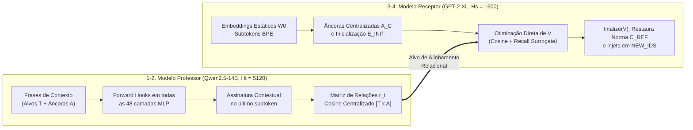

# 01 — Motivação, Mecanismo de Transferência e Escala Experimental ($\phi$)

[🏠 Voltar ao README Principal](../README.md) | **Capítulo 01** | [Próximo: 02 — Exp. 1: Generalização Treino vs. Teste ➡️](02_Exp1_Generalizacao_Treino_Teste.md)

---

> **Alinhamento com a Apresentação (`Plano de Progressão.pdf` — Slides 1 a 4 e 8 a 10):**
> - **Slide 1 (Capa):** *Transferência de Vocabulário por Ativações entre LLMs* — Marcelo Montandon Magalhães (RA: 259118) & Mateus Leite de Souza Lima (RA: 239861).
> - **Slide 2 (Motivação):** Modelos diferentes tokenizam o mundo de formas diferentes; queremos transferir conceitos multi-token de um modelo maior (**Professor**) para um novo token único em um modelo menor (**Receptor / Student**) sem re-treinar o receptor inteiro.
> - **Slide 3 (O Mecanismo em 4 Passos):** Como transferir um conceito quando os espaços latentes têm dimensões incompatíveis ($d_{\text{prof}} = 5120 \neq d_{\text{rec}} = 1600$)? Através de **Representações Relativas** sobre palavras-âncora compartilhadas.
> - **Slide 4 (Hipóteses H1 e H2):** Mais âncoras (H1) e âncoras intencionais por domínio (H2) melhoram o alinhamento geométrico e a geração?

---

## 1. O Problema: Assimetria de Tokenização e Dimensão entre LLMs

Quando um termo técnico ou científico — como `photosynthesis`, `bioluminescence`, `thermodynamics` ou `electroencephalography` — não existe como token único no vocabulário do modelo receptor (`GPT-2`, $|V| = 50.257$), ele é quebrado em múltiplos subtokens BPE arbitrários (ex.: `[" photo", "synth", "esis"]`).

Nosso objetivo é **expandir cirurgicamente o vocabulário do receptor** adicionando um único ID de token novo para cada conceito-alvo e sintetizando seu vetor de embedding $v_t \in \mathbb{R}^{H_s}$ a partir do conhecimento interno de um **Professor** muito maior (`Qwen/Qwen2.5-14B`, $H_t = 5120$), **congelando 100% dos parâmetros originais de ambos os modelos**.

---

## 2. O Mecanismo em 4 Passos (Slide 3)

Como $H_t = 5120$ (`Qwen2.5-14B`) e $H_s = 1600$ (`gpt2-xl`), não podemos copiar vetores diretamente. O **Método A** resolve essa incompatibilidade projetando tanto os alvos quanto um conjunto de **âncoras compartilhadas** $\mathcal{A} = \{a_1, \dots, a_{N_A}\}$ em um espaço de coordenadas relacionais invariante à dimensão:

### Passo a Passo Matemático e Módulos Correspondentes

1. **Extração Contextual no Professor ([`src/teacher_signatures.py`](../src/teacher_signatures.py)):**
   Para cada palavra $w \in \mathcal{T} \cup \mathcal{A}$ inserida em templates contextuais (ex.: `"In a scientific context, the word {word} refers to"`), capturamos a ativação de saída da camada MLP $\ell$ exatamente na posição do **último subtoken** de $w$. Tirando a média entre os templates ativos e centralizando pela média $\mu_T$, obtemos a matriz de similaridades relativas do professor:
   $$R^{\text{prof}}_{t, a} = \frac{\langle \tilde{h}_t^{(\ell)}, \tilde{h}_a^{(\ell)} \rangle}{\|\tilde{h}_t^{(\ell)}\|_2 \, \|\tilde{h}_a^{(\ell)}\|_2}, \quad \tilde{h}_w^{(\ell)} = h_w^{(\ell)} - \mu_T$$

2. **Espaço Centralizado e Inicialização no Receptor ([`src/student_model.py`](../src/student_model.py)):**
   No `GPT-2`, cada âncora $a$ e cada alvo $t$ recebe inicialmente a média aritmética dos embeddings de seus subtokens (`piece_mean`):
   $$e_w = \frac{1}{|S(w)|} \sum_{i \in S(w)} W_0[i]$$
   Centralizamos o espaço pelo centróide $\mu_S = \text{mean}(E_{\text{anch}} \cup E_{\text{init}})$ e guardamos a norma de referência original de cada alvo:
   $$C_{\text{ref}}(t) = \|e^{\text{init}}_t - \mu_S\|_2$$

3. **Otimização Direta Fora do Grafo ([`src/trainer.py`](../src/trainer.py)):**
   Otimizamos a matriz de novos embeddings $V \in \mathbb{R}^{N_T \times H_s}$ via Adam ($\text{lr} = 0.03$) combinando duas funções objetivo calculadas **apenas nas âncoras de treino** ($\mathcal{A}_{\text{tr}}$):
   - **Perda de Cosseno Padronizada (`cosine`):** MSE entre os *z-scores* das similaridades do receptor $\hat{s}_t$ e do professor $r_t$:
     $$\mathcal{L}_{\text{cos}}(v_t) = \frac{1}{|\mathcal{A}_{\text{tr}}|} \left\| z(\hat{s}_t) - z(r_t) \right\|_2^2, \quad \hat{s}_{t,a} = \frac{v_t - \mu_S}{\|v_t - \mu_S\|_2} \cdot \tilde{a}_a$$
   - **Perda Surrogate de Ranking (`recall_surrogate`):** *Pairwise logistic loss* diferenciável que força as $K=10$ âncoras mais próximas segundo o professor ($\mathcal{P}_t$) a terem pontuação superior às demais ($\mathcal{N}_t$) por uma margem $m = 0.10$:
     $$\mathcal{L}_{\text{rank}}(v_t) = \frac{1}{|\mathcal{P}_t| |\mathcal{N}_t|} \sum_{p \in \mathcal{P}_t} \sum_{n \in \mathcal{N}_t} \log\!\left(1 + \exp\big(m - (\hat{s}_{t,p} - \hat{s}_{t,n})\big)\right)$$
   - **Objetivo Combinado (`combined`):**
     $$\mathcal{L}_{\text{comb}}(v_t) = \mathcal{L}_{\text{cos}}(v_t) + \lambda_{\text{rank}} \mathcal{L}_{\text{rank}}(v_t), \quad \lambda_{\text{rank}} = 0.5$$

4. **Restauração de Norma e Pesos Amarrados ([`src/student_model.py`](../src/student_model.py) — Slides 8 a 10):**
   Como a similaridade de cosseno é cega à magnitude ($\|\alpha u\| = \|u\|$), o otimizador pode produzir vetores com normas arbitrárias. Em modelos como o `GPT-2`, onde a matriz de entrada e a `lm_head` de saída compartilham pesos (**Weight Tying = True**), uma norma descalibrada distorce os logits de geração. Por isso, `finalize(V)` restaura a norma radial da inicialização:
   $$v_t^{\text{final}} = \mu_S + C_{\text{ref}}(t) \cdot \frac{v_t - \mu_S}{\|v_t - \mu_S\|_2}$$

---

## 3. Escada de Escala Experimental ($\phi = 0 \dots 5$) em [`src/config.py`](../src/config.py)

Para garantir reprodutibilidade desde CPU / GPUs modestas (Colab T4, 15 GB) até GPUs de servidor (A100, 40–80 GB), um único parâmetro $\phi$ (`MODEL_SCALE`) escala simultaneamente **8 eixos experimentais**:

| Escala $\phi$ | Modelo Professor | Modelo Receptor (`Student`) | Alvos ($N_T$) | Âncoras ($N_A$, teto pool=80) | Templates Treino | Seeds | Épocas | VRAM Estimada |
| :---: | :--- | :--- | :---: | :---: | :---: | :---: | :---: | :---: |
| **0** | `Qwen/Qwen2.5-0.5B` | `openai-community/gpt2` | 8 | 80 *(860)* | 4 | 3 | 120 | ~3.2 GB |
| **1** | `Qwen/Qwen2.5-0.5B` | `openai-community/gpt2-medium` | 11 | 80 *(869)* | 4 | 4 | 140 | ~3.7 GB |
| **2** | `Qwen/Qwen2.5-1.5B` | `openai-community/gpt2-medium` | 15 | 80 *(877)* | 5 | 5 | 160 | ~5.8 GB |
| **3** | `Qwen/Qwen2.5-3B` | `openai-community/gpt2-large` | 20 | 80 *(886)* | 6 | 6 | 180 | ~9.7 GB |
| **4** | `Qwen/Qwen2.5-7B` | `openai-community/gpt2-xl` | 27 | 80 *(895)* | 6 | 7 | 200 | ~20.4 GB |
| **5 ★** | **`Qwen/Qwen2.5-14B`** | **`openai-community/gpt2-xl`** | **36** | **80 *(904)*** | **7 / 8** | **9** | **220** | **~34.7 GB (A100)** |

> [!IMPORTANT]
> **Configuração Executada nos Resultados deste Repositório ($\phi = 5$):**
> - **Hardware:** NVIDIA A100-SXM4-40GB (`39.6 GB VRAM`, `bfloat16`).
> - **Filtro de Vocabulário:** Das 38 palavras do `TARGET_POOL`, 2 foram automaticamente descartadas (`['cardiovascular', 'biodiversity']`) por já existirem como token único no `gpt2-xl`, restando **36 alvos genuinamente multi-token** (`Vocab: 50257 -> 50293`).
> - **Padrão-Ouro Semântico (`GOLD`):** Matriz binária/inteira $[36 \times 80]$ baseada no compartilhamento de 13 domínios científicos (`bio`, `chem`, `phys`, `neuro`, `med`, `earth`, `astro`, `cs`, `math`, `ener`, `mat`, `env`, `gen`), onde **39,5%** dos pares possuem relevância $> 0$.

---

[🏠 Voltar ao README Principal](../README.md) | **Capítulo 01** | [Próximo: 02 — Exp. 1: Generalização Treino vs. Teste ➡️](02_Exp1_Generalizacao_Treino_Teste.md)
