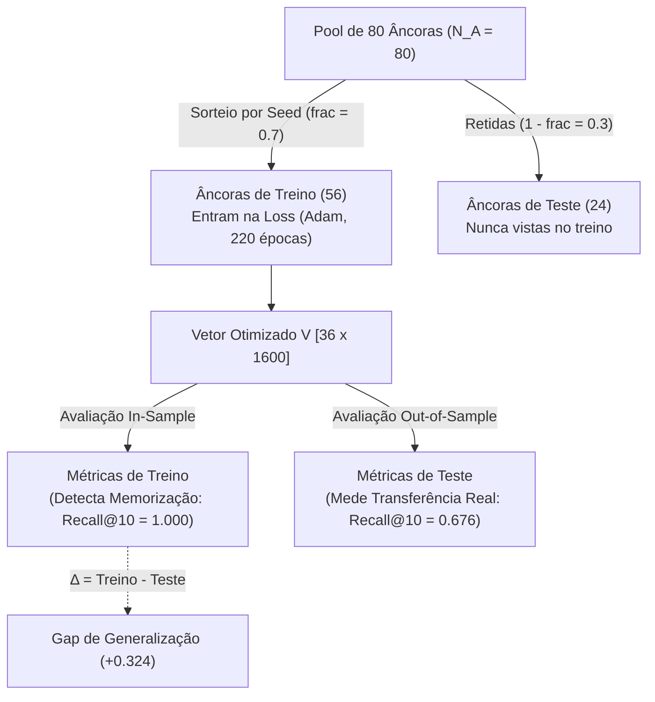
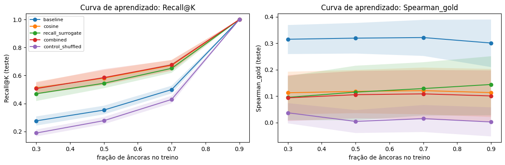

# 02 — Experimento 1: Separação de Âncoras de Treino e Teste (Generalização vs. Memorização)

[⬅️ Anterior: 01 — Motivação, Mecanismo e Escala](01_Motivacao_Mecanismo_e_Escala.md) | [🏠 README Principal](../README.md) | [Próximo: 03 — Exp. 2: Estabilidade entre Seeds ➡️](03_Exp2_Estabilidade_Seeds.md)

---

> **Alinhamento com a Apresentação (`Plano de Progressão.pdf` — Slides 4 e 5) e Código ([`src/experiments.py`](../src/experiments.py)):**
> - **Pergunta Científica:** O vetor aprendido $v_t \in \mathbb{R}^{1600}$ ordena corretamente âncoras que **nunca viu durante a otimização**, ou os valores perfeitos (`1.000`) observados na versão preliminar eram apenas memorização algébrica?
> - **Por que a versão preliminar decorava?** Como o espaço do receptor possui $H_s = 1600$ graus de liberdade e a perda impõe apenas $N_{\text{tr}} = 56$ restrições escalares por alvo ($N_{\text{tr}} \ll H_s$), o sistema linear é subdeterminado: é trivial obter erro zero nas âncoras de treino sem aprender a geometria real do espaço.

---

## 1. Desenho Experimental (Split de Âncoras + Controle Negativo)

Em cada repetição (`run_trial` em [`src/trainer.py`](../src/trainer.py)), particionamos as $N_A = 80$ âncoras em dois subconjuntos disjuntos (`MAIN_FRAC = 0.7`):
- **Treino (`train`, ~56 âncoras):** únicas âncoras vistas pela função de perda ($\mathcal{L}_{\text{cos}}$, $\mathcal{L}_{\text{rank}}$).
- **Teste (`test`, ~24 âncoras):** âncoras retidas (*held-out*), usadas exclusivamente para medir a capacidade de generalização fora da amostra.
- **Controle Negativo (`control_shuffled`):** treina com o objetivo `combined`, mas com as relações alvo-âncora do professor **embaralhadas aleatoriamente** no treino, e avalia contra as relações verdadeiras no teste. Se o pipeline não tiver vazamento de dados (*data leakage*), o controle deve colapsar para o nível de acaso ($\text{Recall@10} \approx 10/24 = 0.417$, $\text{Spearman} \approx 0.000$).

---

## 2. Resultados Quantitativos ($\phi = 5$, Camada Principal $\ell = 47$)

Valores reportados como **Média [IC 95% via Bootstrap Agrupado $2000\times$ em `seeds × alvos`]** ([`src/stats.py`](../src/stats.py)):

### 2.1. Comparação Direta: `train` vs. `test`

| Split | Método | `Recall@10` (vs. Prof.) | `nDCG@10` (vs. Prof.) | `Spearman` (vs. Prof.) | `nDCG@10_gold` (Semântico) | `Spearman_gold` (Semântico) |
| :--- | :--- | :---: | :---: | :---: | :---: | :---: |
| **`test`** *(Âncoras Novas)* | `baseline` *(Média Subtokens)* | `0.499 [0.472, 0.527]` | `0.610 [0.571, 0.650]` | `0.199 [0.140, 0.257]` | **`0.635 [0.578, 0.685]`** | **`0.321 [0.252, 0.388]`** |
| **`test`** *(Âncoras Novas)* | `cosine` | `0.673 [0.632, 0.712]` | **`0.859 [0.827, 0.889]`** | `0.587 [0.515, 0.650]` | `0.489 [0.418, 0.554]` | `0.121 [0.031, 0.208]` |
| **`test`** *(Âncoras Novas)* | `recall_surrogate` | `0.651 [0.619, 0.686]` | `0.807 [0.766, 0.847]` | `0.493 [0.434, 0.553]` | `0.493 [0.417, 0.566]` | `0.129 [0.027, 0.228]` |
| **`test`** *(Âncoras Novas)* | **`combined`** | **`0.676 [0.638, 0.710]`** | `0.855 [0.821, 0.889]` | **`0.591 [0.518, 0.656]`** | `0.478 [0.409, 0.544]` | `0.109 [0.012, 0.199]` |
| **`test`** *(Âncoras Novas)* | `control_shuffled` | `0.429 [0.402, 0.455]` | `0.512 [0.460, 0.559]` | `0.011 [-0.036, 0.055]` | `0.401 [0.360, 0.443]` | `0.015 [-0.036, 0.066]` |
| **`test`** *(Âncoras Novas)* | `teacher_ceiling` *(Teto)* | — | — | — | `0.484 [0.431, 0.532]` | `0.129 [0.073, 0.185]` |
| **`train`** *(Âncoras Vistas)* | `baseline` | `0.284 [0.253, 0.316]` | `0.555 [0.500, 0.610]` | `0.179 [0.122, 0.238]` | `0.600 [0.541, 0.654]` | `0.303 [0.249, 0.354]` |
| **`train`** *(Âncoras Vistas)* | `cosine` | **`1.000 [1.000, 1.000]`** | **`1.000 [1.000, 1.000]`** | **`1.000 [1.000, 1.000]`** | `0.415 [0.349, 0.472]` | `0.122 [0.058, 0.182]` |
| **`train`** *(Âncoras Vistas)* | `recall_surrogate` | `0.998 [0.995, 1.000]` | `0.979 [0.963, 0.990]` | `0.682 [0.650, 0.714]` | `0.421 [0.350, 0.486]` | `0.137 [0.043, 0.228]` |
| **`train`** *(Âncoras Vistas)* | `combined` | **`1.000 [1.000, 1.000]`** | `0.999 [0.999, 1.000]` | `0.994 [0.993, 0.996]` | `0.422 [0.356, 0.481]` | `0.123 [0.056, 0.184]` |
| **`train`** *(Âncoras Vistas)* | `control_shuffled` | `0.175 [0.156, 0.193]` | `0.415 [0.359, 0.470]` | `-0.002 [-0.028, 0.022]` | `0.344 [0.311, 0.382]` | `-0.001 [-0.028, 0.024]` |

---

### 2.2. Testes Pareados: Gap de Generalização e Ganho Real sobre a Baseline

#### A. Gap de Generalização ($\Delta = \text{train} - \text{test}$, pareado por `seed × alvo`)
| Método | Métrica | $\Delta (\text{train} - \text{test})$ | IC 95% | Significativo? | Diagnóstico |
| :--- | :--- | :---: | :---: | :---: | :--- |
| `cosine` | `Recall@10` | **`+0.327`** | `[+0.288, +0.369]` | **Sim** | Forte sobreajuste às âncoras de treino |
| `cosine` | `Spearman` | **`+0.413`** | `[+0.350, +0.485]` | **Sim** | Memorização perfeita no treino (`1.000`) |
| `recall_surrogate` | `Recall@10` | **`+0.347`** | `[+0.312, +0.379]` | **Sim** | Otimiza apenas o topo no treino |
| `combined` | `Recall@10` | **`+0.324`** | `[+0.288, +0.362]` | **Sim** | Confirma que avaliar no treino infla a métrica |
| `combined` | `Spearman` | **`+0.404`** | `[+0.339, +0.476]` | **Sim** | Queda de `0.994` (treino) para `0.591` (teste) |

#### B. Ganho Real no Teste ($\Delta = \text{método} - \text{baseline}$, âncoras novas)
| Método | Métrica | $\Delta (\text{método} - \text{baseline})$ | IC 95% | Significativo? | Interpretação |
| :--- | :--- | :---: | :---: | :---: | :--- |
| **`combined`** | **`Recall@10` (Fidelidade)** | **`+0.177`** | **`[+0.127, +0.227]`** | **Sim ✅** | Transferência geométrica real para âncoras não vistas |
| **`combined`** | **`Spearman` (Fidelidade)** | **`+0.392`** | **`[+0.315, +0.464]`** | **Sim ✅** | Triplica a correlação de ranking com o professor (`0.199 -> 0.591`) |
| `control_shuffled` | `Recall@10` (Fidelidade) | `-0.070` | `[-0.107, -0.032]` | **Sim ✅** | Cai exatamente para o nível de acaso (`0.429`), provando zero vazamento |
| **`combined`** | **`Spearman_gold` (Domínio)** | **`-0.213`** | **`[-0.312, -0.114]`** | **Sim ⚠️** | **Piora na métrica externa!** Por quê? Porque a camada 47 do professor tem teto baixo (`0.129` vs `0.321` da baseline — resolvido no [Cap. 05](05_Exp4_Camadas_MLP_e_PARAM_WIP.md)) |

---

## 3. Curva de Aprendizado por Fração de Âncoras (`FRACS = [0.25, 0.5, 0.7, 0.85]`)

### Três Conclusões Fundamentais do Experimento 1:
1. **Explicação do `1.000` antigo:** No split de treino (`train`), `cosine` e `combined` atingem `1.000` cravado em `Recall@10` e `nDCG@10` porque um vetor de dimensão $1600$ tem graus de liberdade de sobra para interpolar $56$ produtos internos.
2. **Existência de Sinal Genuíno de Transferência:** Mesmo nas âncoras retidas (`test`), `combined` supera a `baseline` em **`+17.7` pontos percentuais** em `Recall@10` e **`+0.392`** em `Spearman`, com ganho crescente conforme aumentamos a fração de âncoras de treino de `0.25` para `0.85` (gráfico à esquerda).
3. **O Paradoxo da Última Camada (`Spearman_gold` no gráfico à direita):** Imitar fielmente a **última camada ($\ell = 47$)** do `Qwen2.5-14B` **reduz** a correlação com os domínios científicos externos (`GOLD`), pois a camada 47 já está especializada na predição do próximo token e seu próprio teto (`teacher_ceiling = 0.129`) é inferior à média estática dos subtokens do `GPT-2` (`baseline = 0.321`). Esse achado motiva diretamente o **Experimento 4** ([Capítulo 05](05_Exp4_Camadas_MLP_e_PARAM_WIP.md)).

---

[⬅️ Anterior: 01 — Motivação, Mecanismo e Escala](01_Motivacao_Mecanismo_e_Escala.md) | [🏠 README Principal](../README.md) | [Próximo: 03 — Exp. 2: Estabilidade entre Seeds ➡️](03_Exp2_Estabilidade_Seeds.md)
