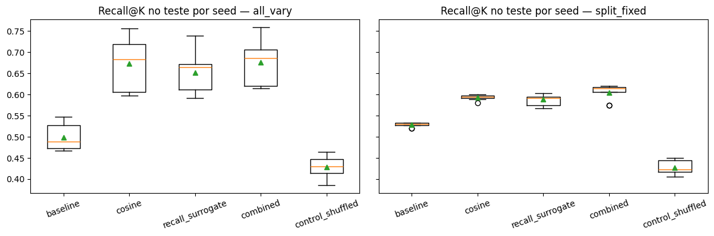

# 03 — Experimento 2: Estabilidade entre Seeds e Sensibilidade à Partição de Âncoras

[⬅️ Anterior: 02 — Exp. 1: Generalização Treino vs. Teste](02_Exp1_Generalizacao_Treino_Teste.md) | [🏠 README Principal](../README.md) | [Próximo: 04 — Exp. 3: Novos Contextos e Uso Funcional ➡️](04_Exp3_Contextos_e_Uso_Funcional.md)

---

> **Alinhamento com a Apresentação (`Plano de Progressão.pdf` — Slides 4 e 5) e Código ([`src/experiments.py`](../src/experiments.py)):**
> - **Pergunta Científica:** O ganho observado no Experimento 1 é um artefato de uma semente aleatória sortuda, ou o método é robusto através de múltiplas inicializações, subconjuntos de templates e partições de âncoras?
> - **Decomposição da Variância:** Qual fonte de aleatoriedade domina a incerteza do método — o ruído da otimização/templates ou a escolha de **quais âncoras** caem no conjunto de treino vs. teste?

---

## 1. Desenho Experimental: `all_vary` vs. `split_fixed`

Ao longo de $S = 9$ seeds (`SEEDS = 0..8`), executamos dois regimes paralelos (`run_all_trials` em [`src/experiments.py`](../src/experiments.py)):
1. **`all_vary` (Variação Total):** Cada seed sorteia (a) uma nova partição de âncoras $70\%/30\%$, (b) $7$ dentre os $8$ templates de treino e (c) um novo ruído gaussiano de inicialização em torno de `E_INIT` (`INIT_NOISE = 0.05`).
2. **`split_fixed` (Partição Fixa):** Congela a partição de âncoras (`split_seed = 0`), variando apenas os templates de treino e o ruído de inicialização do otimizador. Isso permite **isolar a variância intrínseca do treino** e medir a concordância exata dos vizinhos mais próximos via **Índice de Jaccard** entre pares de seeds:
   $$\text{Jaccard}(s_1, s_2) = \frac{1}{N_T} \sum_{t=1}^{N_T} \frac{|\text{TopK}_t^{(s_1)} \cap \text{TopK}_t^{(s_2)}|}{|\text{TopK}_t^{(s_1)} \cup \text{TopK}_t^{(s_2)}|}$$

---

## 2. Resultados Quantitativos ($\phi = 5$, 9 Seeds)

### 2.1. Distribuição das Médias por Seed no Teste (`mean`, `std`, `min`, `max`)

| Modo | Método | `Recall@10` (Média ± DP) | `Recall@10` `[Min, Max]` | `Spearman` (Média ± DP) | `Spearman_gold` (Média ± DP) |
| :--- | :--- | :---: | :---: | :---: | :---: |
| **`all_vary`** | `baseline` | `0.499 ± 0.036` | `[0.453, 0.567]` | `0.199 ± 0.068` | `0.321 ± 0.052` |
| **`all_vary`** | `cosine` | `0.673 ± 0.056` | `[0.608, 0.761]` | `0.587 ± 0.070` | `0.121 ± 0.072` |
| **`all_vary`** | `recall_surrogate` | `0.651 ± 0.043` | `[0.586, 0.728]` | `0.493 ± 0.069` | `0.129 ± 0.085` |
| **`all_vary`** | **`combined`** | **`0.676 ± 0.051`** | **`[0.614, 0.758]`** | **`0.591 ± 0.068`** | `0.109 ± 0.071` |
| **`all_vary`** | `control_shuffled` | `0.429 ± 0.035` | `[0.381, 0.483]` | `0.011 ± 0.072` | `0.015 ± 0.076` |
| **`split_fixed`** | `baseline` | `0.506 ± 0.000` | `[0.506, 0.506]` | `0.214 ± 0.000` | `0.391 ± 0.000` |
| **`split_fixed`** | `cosine` | `0.603 ± 0.016` | `[0.578, 0.625]` | `0.464 ± 0.019` | `0.061 ± 0.014` |
| **`split_fixed`** | `recall_surrogate` | `0.585 ± 0.015` | `[0.561, 0.606]` | `0.371 ± 0.015` | `0.097 ± 0.014` |
| **`split_fixed`** | **`combined`** | **`0.605 ± 0.018`** | **`[0.575, 0.619]`** | **`0.465 ± 0.019`** | `0.044 ± 0.011` |
| **`split_fixed`** | `control_shuffled` | `0.432 ± 0.038` | `[0.392, 0.503]` | `0.025 ± 0.052` | `0.017 ± 0.054` |

---

### 2.2. Taxa de Vitória sobre a Baseline e Consistência Top-10 (Jaccard)

| Métrica de Estabilidade | `baseline` | `cosine` | `recall_surrogate` | **`combined`** | `control_shuffled` |
| :--- | :---: | :---: | :---: | :---: | :---: |
| **Taxa de Vitória vs. `baseline` (`all_vary`, 9 seeds)** | — | **`100%` (9/9)** | **`100%` (9/9)** | **`100%` (9/9)** | `0%` (0/9) |
| **Jaccard Médio Top-10 entre Pares de Seeds (`split_fixed`)** | `1.000` | `0.853` | **`0.911`** | **`0.882`** | `0.275` |

---

## 3. Visualização Boxplot: `all_vary` vs. `split_fixed`

### Principais Diagnósticos do Experimento 2:
1. **Superioridade Unânime entre Seeds:** Em **100% das seeds (9 de 9)**, os três métodos de alinhamento (`cosine`, `recall_surrogate` e `combined`) superam a `baseline` em `Recall@10` nas âncoras de teste, enquanto o `control_shuffled` perde em **100% das seeds** (`0%` de vitórias).
2. **A Escolha das Âncoras Domina a Variância:** Quando fixamos o split de âncoras (`split_fixed`, gráfico à direita), o desvio-padrão entre seeds do método `combined` cai quase **3 vezes** — de **`0.051`** (`all_vary`) para apenas **`0.018`** (`split_fixed`). Isso demonstra que a otimização via Adam converge para soluções altamente consistentes (Jaccard de **`0.882`** a **`0.911`** nos top-10 vizinhos), mas o método é sensível a **quais âncoras discretas** estão disponíveis. Esse achado motiva diretamente o uso de **âncoras aprendidas como misturas convexas (PARAM)** no Slide 12 ([Capítulo 05](05_Exp4_Camadas_MLP_e_PARAM_WIP.md)).

---

[⬅️ Anterior: 02 — Exp. 1: Generalização Treino vs. Teste](02_Exp1_Generalizacao_Treino_Teste.md) | [🏠 README Principal](../README.md) | [Próximo: 04 — Exp. 3: Novos Contextos e Uso Funcional ➡️](04_Exp3_Contextos_e_Uso_Funcional.md)
