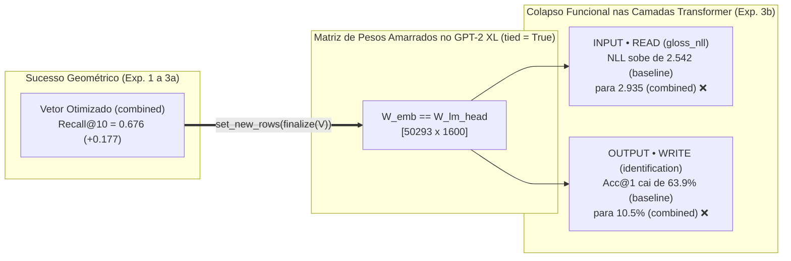

# 04 — Experimento 3: Novos Contextos (3a) e o Colapso Funcional na Geração (3b)

[⬅️ Anterior: 03 — Exp. 2: Estabilidade entre Seeds](03_Exp2_Estabilidade_Seeds.md) | [🏠 README Principal](../README.md) | [Próximo: 05 — Exp. 4: Camadas do MLP e PARAM + WIP ➡️](05_Exp4_Camadas_MLP_e_PARAM_WIP.md)

---

> **Alinhamento Direto com o Coração da Apresentação (`Plano de Progressão.pdf` — Slides 5 a 11):**
> - **Slide 5 (Métricas Discordam):** Um método pode vencer em `Recall@10`, `nDCG@10` e `Spearman` contra o professor, mas **fracassar funcionalmente** quando inserido no modelo receptor.
> - **Slides 6 e 7 (`UNTRAINED` vence `METRIC-BEST`):** Ao gerar texto com o novo token no `GPT-2`, a inicialização **sem treino (`baseline` / `UNTRAINED`)** supera amplamente os vetores otimizados (`cosine`, `recall_surrogate`, `combined`), que sofrem colapso funcional ou geram texto genérico.
> - **Slides 8 e 9 (Causa Raiz — *Tied Weights* e Geometria vs. Logits):** No `GPT-2`, a matriz de entrada `wte` e a matriz de saída `lm_head` são **o mesmo tensor na memória (`weight tying: True`)**. Otimizar apenas ângulos de cosseno em relação a um subconjunto de âncoras move o vetor para uma região onde o Transformer do `GPT-2` perde a capacidade de predizer a definição da palavra.

---

## 1. Experimento 3a — Generalização para Novos Contextos do Professor (`test_newctx`)

Nos Experimentos 1 e 2, os templates de treino colocavam a palavra-alvo **no final do prefixo** (ex.: `"In a scientific context, the word {word} refers to"`), de modo que a máscara causal do `Qwen2.5-14B` via apenas o contexto à esquerda.

No **Experimento 3a** (`run_experiment_3a` em [`src/experiments.py`](../src/experiments.py)), avaliamos **os mesmos vetores aprendidos** contra as assinaturas do professor extraídas de **5 templates inéditos (`HELDOUT_TEMPLATES`)** onde a palavra aparece **no meio da frase** (ex.: `"Researchers studying {word} observed that the phenomenon depends on several factors."`), nas âncoras de teste (duplamente fora da amostra: **âncoras novas × contextos novos**).

### Resultados 3a ($\phi = 5$, Camada 47, Âncoras de Teste)

| Split de Contexto | Método | `Recall@10` (vs. Prof.) | `nDCG@10` (vs. Prof.) | `Spearman` (vs. Prof.) | Ganho $\Delta\text{Recall@10}$ vs. `baseline` |
| :--- | :--- | :---: | :---: | :---: | :---: |
| **`test`** *(Templates de Treino)* | `baseline` | `0.499 [0.472, 0.527]` | `0.610 [0.571, 0.650]` | `0.199 [0.140, 0.257]` | — |
| **`test`** *(Templates de Treino)* | **`combined`** | **`0.676 [0.638, 0.710]`** | **`0.855 [0.821, 0.889]`** | **`0.591 [0.518, 0.656]`** | **`+0.177 [+0.127, +0.227]` ✅** |
| **`test_newctx`** *(Frases Novas)* | `baseline` | `0.470 [0.440, 0.503]` | `0.583 [0.543, 0.625]` | `0.151 [0.095, 0.210]` | — |
| **`test_newctx`** *(Frases Novas)* | `cosine` | `0.678 [0.641, 0.715]` | **`0.850 [0.820, 0.878]`** | `0.562 [0.492, 0.625]` | **`+0.208 [+0.165, +0.253]` ✅** |
| **`test_newctx`** *(Frases Novas)* | `recall_surrogate` | `0.645 [0.612, 0.679]` | `0.799 [0.765, 0.831]` | `0.470 [0.415, 0.525]` | **`+0.174 [+0.132, +0.217]` ✅** |
| **`test_newctx`** *(Frases Novas)* | **`combined`** | **`0.681 [0.645, 0.717]`** | `0.847 [0.816, 0.876]` | **`0.565 [0.495, 0.629]`** | **`+0.210 [+0.169, +0.253]` ✅** |
| **`test_newctx`** *(Frases Novas)* | `teacher_ceiling` | `0.807 [0.764, 0.847]` | `0.946 [0.929, 0.960]` | `0.812 [0.768, 0.851]` | *(Concordância interna do Prof.)* |

> [!TIP]
> **Conclusão 3a:** A assinatura extraída do professor **não é um artefato superficial do template**. A concordância entre as relações do professor em templates de treino e em frases inéditas tem teto `Recall@10 = 0.807` e `Spearman = 0.812`, e o vetor `combined` mantém **100% do seu ganho geométrico** (`+0.210` em `Recall@10`, `+0.414` em `Spearman`).

---

## 2. Experimento 3b — O Choque de Realidade: Uso Funcional no Receptor (Slides 6 a 9)

Passar nos testes geométricos (Exp. 1, 2 e 3a) garante que o `GPT-2` consiga **usar** o novo token para ler e escrever texto? Para testar isso sem depender apenas de inspeção visual, o **Experimento 3b** (`run_experiment_3b` em [`src/experiments.py`](../src/experiments.py)) injeta os vetores aprendidos nas linhas novas da tabela de embeddings do `gpt2-xl` (`NEW_IDS = 50257..50292`) e mede duas tarefas funcionais baseadas nos **logits reais do receptor**:

1. **Leitura (`NLL` da Definição — *Input / Read* no Slide 8):**
   Dada uma frase como `"In science, <NEW_TOKEN> refers to the process by which plants convert light energy into chemical energy."`, medimos a **Negative Log-Likelihood (NLL)** média por token apenas nos tokens da definição (glossário oficial do conceito). **Quanto menor a NLL, melhor o novo token condiciona o `GPT-2` a prever sua própria definição.**
2. **Escrita (`Acc@1` e `MRR` de Identificação QA — *Output / Write* no Slide 8):**
   Dado o prompt reverso `"The scientific term for the process by which plants convert light energy into chemical energy is"`, olhamos os logits de saída da `lm_head` restritos aos $N_T = 36$ novos tokens e verificamos se o token correto recebe o maior logit (`Acc@1`, acaso $= 1/36 = 0.028$; `MRR`, acaso $= 0.116$).

### Resultados 3b ($\phi = 5$, 36 Alvos × 9 Seeds)

| Método | `NLL` da Definição *(Menor = Melhor)* | `Acc@1` Identificação *(Maior = Melhor)* | `MRR` Identificação *(Maior = Melhor)* | $\Delta\text{NLL}$ vs. `random` *(Pareado)* | $\Delta\text{NLL}$ vs. `baseline` *(Pareado)* |
| :--- | :---: | :---: | :---: | :---: | :---: |
| `subwords` *(Palavra em Subtokens)* | **`1.817 [1.591, 2.069]`** | — | — | `-1.2102` *(Sig. ✅)* | `-0.7254` *(Sig. ✅)* |
| **`baseline` (`UNTRAINED` — Slide 6)** | **`2.542 [2.262, 2.856]`** | **`0.639 [0.486, 0.778]`** | **`0.756 [0.647, 0.855]`** | **`-0.4848`** | `0.0000` *(Referência)* |
| `cosine` | `2.911 [2.681, 3.163]` | `0.157 [0.068, 0.258]` | `0.329 [0.233, 0.427]` | `-0.1161` *(Não sig.)* | **`+0.3686` *(Pior! ⚠️)*** |
| **`combined` (`METRIC-BEST` — Slide 6)** | **`2.935 [2.707, 3.185]`** | **`0.105 [0.028, 0.193]`** | **`0.266 [0.188, 0.348]`** | `-0.0919 [-0.230, +0.046]` *(Não sig.)* | **`+0.3928 [+0.222, +0.567]` *(Pior! ⚠️)*** |
| `recall_surrogate` | `2.947 [2.719, 3.197]` | `0.091 [0.025, 0.167]` | `0.221 [0.156, 0.292]` | `-0.0801` *(Não sig.)* | **`+0.4046` *(Pior! ⚠️)*** |
| `control_shuffled` | `2.999 [2.790, 3.226]` | `0.036 [0.017, 0.059]` | `0.123 [0.099, 0.151]` | `-0.0276` *(Não sig.)* | `+0.4572` *(Pior! ⚠️)* |
| `random` *(Direção Aleatória, Mesma Norma)* | `3.027 [2.827, 3.250]` | `0.039 [0.019, 0.062]` | `0.124 [0.102, 0.149]` | `0.0000` *(Acaso)* | `+0.4848` |
| *Nível de Acaso Teórico ($1/36$)* | — | `0.028` | `0.116` | — | — |

---

## 3. Diagnóstico Profundo (Slides 6 a 11): Por que `UNTRAINED` (`baseline`) vence `combined`?

Os números da tabela acima confirmam com rigor estatístico a descoberta central apresentada nos **Slides 6 a 11** de `Plano de Progressão.pdf`:

1. **`baseline` (`UNTRAINED`) já possui Forte Sinal Lexical e Funcional:**
   A média aritmética dos subtokens BPE (`E_INIT`, sem nenhum passo de otimização) alcança **`Acc@1 = 63.9%`** (contra `2.8%` do acaso!) e **`NLL = 2.542`**. Isso ocorre porque subtokens como `" photo"`, `"synth"`, `"therm"` e `"neuro"` já habitam a sub-variedade (*manifold*) exata que as camadas de autoatenção do `GPT-2` esperam receber na entrada e emitir na `lm_head`.
2. **Destruição da Geometria Funcional pelo Alinhamento Puramente Relacional:**
   Ao otimizarmos $V$ por 220 épocas com $\text{lr} = 0.03$ **sem regularização de proximidade a `E_INIT`** e guiados pela **camada 47** do professor (que tem baixa qualidade semântica externa, como visto no Exp. 1), o vetor $v_t$ é empurrado para longe de `E_INIT` a fim de satisfazer os cossenos das 56 âncoras de treino.
   - Resultado: A `Acc@1` despenca de **`63.9%` para `10.5%`**, e a `NLL` da definição piora em **`+0.3928` nats/token** ($\text{IC 95\% } [+0.222, +0.567]$), ficando estatisticamente indistinguível de um vetor de direção aleatória (`random`, $\Delta = -0.0919$, IC inclui $0$).
3. **Geração Qualitativa (`gen` vs. `generate` em [`src/experiments.py`](../src/experiments.py)):**
   - Quando injetamos o ID real do novo token (`NEW_IDS[t_idx]`) via função `gen("In science,", t, " refers to")` com o vetor `combined`, o `GPT-2` **perde a especificidade semântica** da palavra e emite uma continuação genérica idêntica para conceitos distintos:
     > `"In science, photosynthesis refers to the study of the natural world, and the study of the natural world is the study of the universe..."`
     > `"In science, bioluminescence refers to the study of the properties of light, and the way in which light interacts with matter..."`
   - Além disso, na última célula do notebook original (`generate(prompt)`), passar a palavra como texto puro faz o tokenizador quebrá-la novamente nos subtokens originais (sem acionar `NEW_IDS`), o que mascara o colapso se não usarmos `gen` com injeção explícita de IDs (corrigido no Método B).

---

[⬅️ Anterior: 03 — Exp. 2: Estabilidade entre Seeds](03_Exp2_Estabilidade_Seeds.md) | [🏠 README Principal](../README.md) | [Próximo: 05 — Exp. 4: Camadas do MLP e PARAM + WIP ➡️](05_Exp4_Camadas_MLP_e_PARAM_WIP.md)
