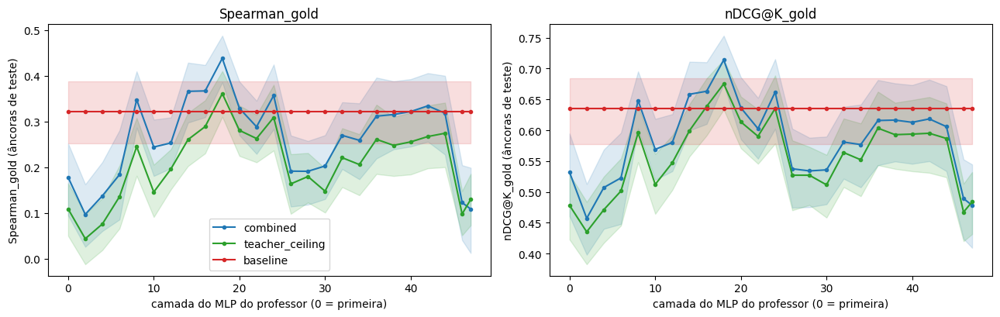
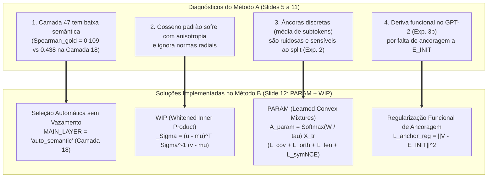

# 05 — Experimento 4: Varredura das Camadas do MLP e Evolução para PARAM + WIP

[⬅️ Anterior: 04 — Exp. 3: Novos Contextos e Uso Funcional](04_Exp3_Contextos_e_Uso_Funcional.md) | [🏠 Voltar ao README Principal](../README.md)

---

> **Alinhamento com a Apresentação (`Plano de Progressão.pdf` — Slides 10 a 12) e Código ([`src/experiments.py`](../src/experiments.py)):**
> - **Pergunta Científica (Exp. 4):** Por que os Experimentos 1 a 3 perderam para a `baseline` na métrica semântica externa (`Spearman_gold`)? Em qual camada das $48$ camadas MLP do `Qwen2.5-14B` a representação semântica de domínio atinge seu ápice?
> - **Slide 11 (Correções Estruturais):** Separar *metric-best* de *generation-best*, calibrar normas/camadas e curar as referências.
> - **Slide 12 (Próximos Passos — Svendsen et al., ICANN 2026):** Substituir âncoras discretas ruidosas por **Misturas Convexas Aprendidas (`PARAM`)** e substituir o cosseno isotrópico por **Produtos Internos Branqueados (`WIP`)**.

---

## 1. Experimento 4 — Varredura das 48 Camadas do MLP do Professor

Comparar diferentes camadas do professor usando a fidelidade contra a *própria* camada seria tautológico (cada camada definiria sua própria régua). Por isso, o **Experimento 4** (`run_experiment_4` em [`src/experiments.py`](../src/experiments.py)) avalia todas as camadas pares ($\ell \in \{0, 2, 4, \dots, 46\} \cup \{47\}$) usando um **juiz externo independente de ambos os modelos**: a correlação `Spearman_gold` e `nDCG@10_gold` com os domínios científicos reais (`GOLD`) nas âncoras de teste.

### Curva Semântica por Camada do MLP ($\phi = 5$, Camadas $0 \dots 47$)

---

## 2. Tabela Completa por Camada do MLP ($\phi = 5$, Método `combined`, Âncoras de Teste)

| Camada MLP ($\ell$) | `Spearman_gold` *(Critério Principal)* | `nDCG@10_gold` *(Semântico)* | `P@10_gold` *(Precisão Domínio)* | Eficiência (`combined / teto`) | `Recall@10` (`test_newctx`, Fidelidade) |
| :---: | :---: | :---: | :---: | :---: | :---: |
| `0` | `0.178 [0.094, 0.252]` | `0.532 [0.460, 0.595]` | `0.459 [0.394, 0.520]` | `1.637` | `0.610 [0.582, 0.639]` |
| `2` | `0.097 [0.026, 0.163]` | `0.457 [0.398, 0.513]` | `0.418 [0.359, 0.476]` | `NaN` *(teto $\le 0.05$)* | `0.683 [0.650, 0.715]` |
| `4` | `0.137 [0.060, 0.211]` | `0.507 [0.440, 0.569]` | `0.448 [0.389, 0.513]` | `1.813` | `0.598 [0.567, 0.629]` |
| `6` | `0.184 [0.086, 0.281]` | `0.523 [0.448, 0.596]` | `0.463 [0.393, 0.534]` | `1.356` | `0.550 [0.514, 0.583]` |
| `8` | `0.348 [0.287, 0.410]` | `0.648 [0.603, 0.695]` | `0.539 [0.484, 0.597]` | `1.420` | `0.611 [0.577, 0.643]` |
| `10` | `0.244 [0.181, 0.304]` | `0.569 [0.520, 0.618]` | `0.489 [0.431, 0.549]` | `1.677` | `0.620 [0.586, 0.653]` |
| `12` | `0.253 [0.198, 0.309]` | `0.580 [0.534, 0.626]` | `0.497 [0.444, 0.553]` | `1.290` | `0.580 [0.541, 0.619]` |
| `14` | `0.366 [0.298, 0.429]` | `0.658 [0.600, 0.711]` | `0.548 [0.491, 0.608]` | `1.405` | `0.606 [0.579, 0.635]` |
| `16` | `0.367 [0.309, 0.424]` | `0.663 [0.610, 0.710]` | `0.548 [0.487, 0.606]` | `1.270` | `0.628 [0.597, 0.656]` |
| **`18 ★`** | **`0.438 [0.386, 0.488]`** | **`0.714 [0.675, 0.753]`** | **`0.592 [0.534, 0.653]`** | **`1.214`** | **`0.634 [0.598, 0.669]`** |
| `20` | `0.329 [0.270, 0.387]` | `0.636 [0.585, 0.686]` | `0.531 [0.476, 0.588]` | `1.172` | `0.601 [0.569, 0.631]` |
| `22` | `0.289 [0.229, 0.345]` | `0.603 [0.554, 0.652]` | `0.512 [0.457, 0.571]` | `1.098` | `0.591 [0.557, 0.624]` |
| `24` | `0.357 [0.283, 0.425]` | `0.662 [0.602, 0.715]` | `0.549 [0.488, 0.612]` | `1.155` | `0.624 [0.590, 0.659]` |
| `26` | `0.191 [0.114, 0.269]` | `0.537 [0.474, 0.602]` | `0.472 [0.406, 0.541]` | `1.170` | `0.661 [0.634, 0.685]` |
| `28` | `0.191 [0.118, 0.257]` | `0.534 [0.475, 0.588]` | `0.464 [0.406, 0.525]` | `1.064` | `0.678 [0.646, 0.710]` |
| `30` | `0.203 [0.130, 0.270]` | `0.536 [0.480, 0.590]` | `0.473 [0.413, 0.536]` | `1.373` | `0.669 [0.635, 0.703]` |
| `32` | `0.270 [0.196, 0.342]` | `0.581 [0.521, 0.638]` | `0.501 [0.440, 0.567]` | `1.221` | `0.697 [0.658, 0.733]` |
| `34` | `0.259 [0.174, 0.340]` | `0.577 [0.507, 0.641]` | `0.497 [0.428, 0.567]` | `1.258` | `0.663 [0.629, 0.694]` |
| `36` | `0.312 [0.219, 0.396]` | `0.616 [0.543, 0.681]` | `0.522 [0.454, 0.590]` | `1.194` | `0.688 [0.660, 0.715]` |
| `38` | `0.315 [0.239, 0.388]` | `0.616 [0.549, 0.676]` | `0.522 [0.456, 0.586]` | `1.272` | `0.679 [0.645, 0.715]` |
| `40` | `0.322 [0.245, 0.393]` | `0.613 [0.546, 0.673]` | `0.524 [0.461, 0.584]` | `1.260` | `0.664 [0.632, 0.694]` |
| `42` | `0.334 [0.256, 0.406]` | `0.618 [0.550, 0.682]` | `0.533 [0.467, 0.598]` | `1.251` | `0.687 [0.651, 0.720]` |
| `44` | `0.318 [0.228, 0.400]` | `0.606 [0.534, 0.671]` | `0.524 [0.454, 0.592]` | `1.160` | `0.711 [0.682, 0.741]` |
| `46` | `0.123 [0.040, 0.204]` | `0.489 [0.424, 0.553]` | `0.442 [0.379, 0.505]` | `1.257` | `0.673 [0.623, 0.725]` |
| `47` *(Última)* | `0.109 [0.012, 0.199]` | `0.478 [0.409, 0.544]` | `0.432 [0.363, 0.501]` | `0.838` | `0.681 [0.645, 0.717]` |
| *Referência `baseline`* | `0.321 [0.252, 0.388]` | `0.635 [0.578, 0.685]` | — | — | `0.470 [0.440, 0.503]` |

### Diagnóstico da Varredura de Camadas:
- **Camada 18 é Vencedora Absoluta (`indist = []`):** A camada intermediária **$\ell = 18$** (~38% da profundidade do `Qwen2.5-14B`) atinge **`Spearman_gold = 0.438 [0.386, 0.488]`** e **`nDCG@10_gold = 0.714 [0.675, 0.753]`**, superando com folga estatística a `baseline` (`0.321` e `0.635`) e superando **todas as demais camadas** (o conjunto de camadas estatisticamente indistinguíveis pelo bootstrap pareado é vazio: `indist = []`).
- **Colapso Semântico nas Camadas 46 e 47:** Nas duas últimas camadas ($\ell = 46, 47$), a representação do MLP deixa de organizar conceitos por domínio semântico e passa a refletir a distribuição de probabilidade do próximo token sintático, derrubando `Spearman_gold` de `0.438` para **`0.109`**.

---

## 3. Fechamento da Apresentação (Slide 12): Evolução para `PARAM + WIP` no Método B

A bateria de validação escalável do **Método A** provou que a transferência entre LLMs de famílias distintas funciona geometricamente, mas revelou **4 gargalos estruturais** que foram diretamente solucionados na **Fase 8** ([`Metodo_B_Validacao_Escalavel.ipynb`](../Metodo_B_Validacao_Escalavel.ipynb) e detalhados em [`relatorio_pos_implementacao.md`](../relatorio_pos_implementacao.md)), incorporando as técnicas de **Svendsen et al. (ICANN 2026)** — *"Improving Relative Representations with Learned Anchors and Whitened Inner Products"*:

### Resumo das Equações do Slide 12 Implementadas em [`Metodo_B_Validacao_Escalavel.ipynb`](../Metodo_B_Validacao_Escalavel.ipynb):

1. **WIP (*Whitened Inner Product* com Regularização de *Shrinkage* $\alpha = 0.10$):**
   Substitui a similaridade de cosseno pelo produto interno branqueado pela inversa da matriz de covariância $\Sigma^{-1}$, corrigindo a anisotropia do espaço de embeddings de LLMs e garantindo invariância a transformações lineares invertíveis:
   $$\text{WIP}(u, v) = \frac{(u - \mu)^\top \Sigma_{\text{reg}}^{-1} (v - \mu)}{\sqrt{d}}, \quad \Sigma_{\text{reg}} = (1 - \alpha)\hat{\Sigma} + \alpha \frac{\text{tr}(\hat{\Sigma})}{d} I_d$$

2. **PARAM (*Parametric Anchors as Convex Mixtures of Datapoints*):**
   Em vez de usar palavras isoladas ruidosas como âncoras, aprende $M$ âncoras virtuais como combinações convexas $P = \text{Softmax}(W / \tau) \in \Delta^{N_{\text{tr}}-1}$ das âncoras de treino nos espaços branqueados do Professor ($Z_T = P \tilde{X}_T$) e do Receptor ($Z_S = P \tilde{X}_S$), minimizando conjuntamente:
   $$\mathcal{L}_{\text{PARAM}}(W) = \lambda_{\text{cov}}\mathcal{L}_{\text{cov}} + \lambda_{\text{orth}}\mathcal{L}_{\text{orth}} + \lambda_{\text{len}}\mathcal{L}_{\text{len}} + \lambda_{\text{nce}}\mathcal{L}_{\text{symNCE}}$$

3. **Ancoragem Funcional ao Espaço do Receptor (`L_anchor_reg`):**
   Adiciona o termo $\gamma_{\text{init}} \|V - E_{\text{init}}\|_2^2$ durante a otimização do método `"param_wip"`, preservando a alta identificabilidade funcional da inicialização (`Acc@1 = 63.9%` e `NLL = 2.542`) enquanto absorve a estrutura relacional da camada semântica ótima do professor.

---

[⬅️ Anterior: 04 — Exp. 3: Novos Contextos e Uso Funcional](04_Exp3_Contextos_e_Uso_Funcional.md) | [🏠 Voltar ao README Principal](../README.md)
